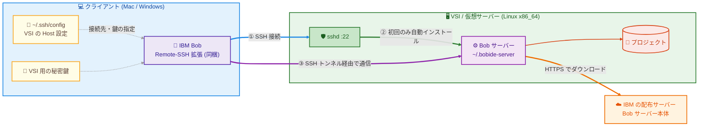

# IBM Bob Remote-SSH 接続ガイドと検証環境

IBM Bob の Remote-SSH で、リモートの Linux サーバー上のプロジェクトを開発するための手順と、その検証環境をまとめたリポジトリ。

- **実業務の接続先**: VSI などの仮想サーバー (Linux)
- **検証環境**: このリポジトリの Docker コンテナ。VSI を用意しなくても、手元で接続を試せる「SSH で入れる Linux」の代わり

Bob から見ると、接続先は Docker コンテナでも VSI でも「SSH でログインできる Linux」であり、Bob 側の手順は同じ。
検証環境は、元記事 [IBM Bob remote SSH with Podman on macOS/Linux](https://www.the-main-thread.com/p/ibm-bob-remote-ssh-podman-macos-linux) の Podman 構成を Docker で再現している。

## 構成図

### 実業務 (VSI / 仮想サーバー)



### 検証環境 (このリポジトリの Docker)

実業務の VSI の部分が、手元の Docker コンテナに置き換わる。

```mermaid
flowchart LR
  subgraph client["💻 クライアント (Mac / Windows)"]
    bob["🤖 IBM Bob<br/>Remote-SSH 拡張 (同梱)"]
    sshcfg["📄 ~/.ssh/config<br/>Host bob-docker-demo"]
    key["🔑 ssh/bob_remote_key<br/>秘密鍵"]
  end

  subgraph docker["🐳 Docker (Mac: Colima / Docker Desktop、Windows: Docker Desktop)"]
    port["🔌 127.0.0.1:2222"]
    subgraph container["📦 コンテナ bob-remote-host (Ubuntu 24.04 / linux/amd64)"]
      sshd["🛡️ sshd :2222<br/>公開鍵認証のみ・bob のみ"]
      server["⚙️ Bob サーバー<br/>~/.bobide-server"]
      ws[("💾 ~/workspace<br/>名前付きボリューム")]
    end
  end

  ibm["☁️ IBM の配布サーバー<br/>Bob サーバー本体"]

  sshcfg -.->|"接続先・鍵の指定"| bob
  key -.-> bob
  bob -->|"① SSH 接続"| port
  port --> sshd
  sshd -->|"② 初回のみ自動インストール"| server
  server -->|"HTTPS でダウンロード"| ibm
  bob -->|"③ SSH トンネル経由で通信"| server
  server --> ws

  %% グループの色
  style client fill:#E3F2FD,stroke:#1E88E5,stroke-width:2px,color:#0D47A1
  style docker fill:#E0F7FA,stroke:#00838F,stroke-width:2px,color:#006064
  style container fill:#E8F5E9,stroke:#2E7D32,stroke-width:2px,color:#1B5E20

  %% ノードの色
  classDef cBob fill:#EDE7F6,stroke:#5E35B1,stroke-width:2px,color:#311B92
  classDef cFile fill:#FFFDE7,stroke:#F9A825,stroke-width:2px,color:#5D4037
  classDef cNet fill:#E1F5FE,stroke:#0288D1,stroke-width:2px,color:#01579B
  classDef cSshd fill:#C8E6C9,stroke:#2E7D32,stroke-width:2px,color:#1B5E20
  classDef cServer fill:#F3E5F5,stroke:#8E24AA,stroke-width:2px,color:#4A148C
  classDef cVol fill:#FBE9E7,stroke:#D84315,stroke-width:2px,color:#BF360C
  classDef cExt fill:#FFF3E0,stroke:#EF6C00,stroke-width:2px,color:#E65100
  class bob cBob
  class sshcfg,key cFile
  class port cNet
  class sshd cSshd
  class server cServer
  class ws cVol
  class ibm cExt

  %% 矢印の色 (定義順: 0 設定, 1 鍵, 2 ①, 3 転送, 4 ②, 5 ダウンロード, 6 ③, 7 保存)
  linkStyle 0,1 stroke:#9E9E9E,stroke-width:1.5px
  linkStyle 2,3 stroke:#1E88E5,stroke-width:3px
  linkStyle 4 stroke:#2E7D32,stroke-width:3px
  linkStyle 5 stroke:#EF6C00,stroke-width:3px
  linkStyle 6 stroke:#8E24AA,stroke-width:3px
  linkStyle 7 stroke:#D84315,stroke-width:2px
```



どちらも流れは同じ。

1. Bob が `~/.ssh/config` の Host 設定を使ってリモートに SSH 接続する (検証環境では、Docker が `127.0.0.1:2222` をコンテナの sshd に転送する)
2. 初回接続時、Bob がリモートに Bob サーバーを自動でインストールする (IBM の配布サーバーからダウンロード)
3. 以降の編集・ターミナル・ファイル操作は、SSH のポートフォワード経由で Bob サーバーと通信して行う

## 使い方

### 実業務 (VSI / 仮想サーバー) に接続する

1. VSI が下の「[リモート側の要件](#リモート側の要件)」を満たしていることを確認する
2. ターミナルから VSI に SSH でログインできることを確認する
3. [bob-remote-ssh.md](bob-remote-ssh.md) の手順で接続する。その際、`~/.ssh/config` に貼る Host ブロックは VSI 用のものにし、手順中の `bob-docker-demo` は自分で付けた Host 名に読み替える

VSI 用の Host ブロックの例 (Port を省略すると 22):

```sshconfig
Host my-vsi
  HostName <VSI の IP アドレスまたはホスト名>
  User <ログインユーザー>
  IdentityFile <VSI 用の秘密鍵のパス>
  IdentitiesOnly yes
```

### 検証環境 (Docker) で試す

次の順に行う。どちらも Mac / Windows の両方を記載している (Windows は実機未検証)。

1. [docker-setup.md](docker-setup.md) — 検証用のリモート環境 (Docker コンテナ) のセットアップ
2. [bob-remote-ssh.md](bob-remote-ssh.md) — Bob からのリモート接続

Bob 側に追加のインストールは不要 (Remote-SSH 拡張は Bob に同梱されている)。

## リモート側の要件

基本的に、**SSH で接続できるリモートであれば Bob からも接続できる**。
Bob サーバーは初回接続時に Bob が自動でインストール・起動するので、リモート側で Bob 用のインストールや設定は不要。VSI などの仮想サーバーでも同じ。

### Bob サーバーが自動でインストールされる流れ

1. Bob が SSH でログインし、Bob に同梱のインストールスクリプトをリモートで実行する
2. スクリプトがリモートの OS とアーキテクチャを判定し、対応する Bob サーバーを IBM の配布サーバー (`api.us-east.bob.ibm.com`) からダウンロードして `~/.bobide-server` に展開する
3. Bob サーバーを `127.0.0.1` の空きポートで起動し、Bob は SSH のポートフォワード経由でそこに接続する

2 回目以降はインストール済みのものを使う。Bob を更新すると、そのバージョンの Bob サーバーが同じ流れで自動的に追加される。

### 自動インストールの条件

SSH でログインできることに加えて、次を満たす必要がある。

| 条件 | 理由・補足 |
| --- | --- |
| SSH の TCP ポートフォワードが許可されている (`AllowTcpForwarding yes`) | Bob はポートフォワード経由で Bob サーバーと通信する。禁止されていると、SSH ログインはできても Bob は接続できない。OpenSSH の既定は許可だが、セキュリティ強化済みのイメージでは禁止されていることがある |
| Linux の x86_64 (または ppc64le) | Bob サーバーが配布されているのは linux/x64 と linux/ppc64le のみ。arm64、s390x、Alpine Linux 向けは配布されていない |
| glibc 2.28 以上 | Bob サーバーに同梱の Node.js が要求する。目安は RHEL 8 以降、Ubuntu 20.04 以降、Debian 10 以降 (CentOS 7 や Ubuntu 18.04 は不可) |
| リモートから `api.us-east.bob.ibm.com` に HTTPS で出られる | Bob サーバーはリモート側がダウンロードする。IBM Cloud VPC の VSI なら、パブリックゲートウェイなどで外部に出られるようにする。プロキシが必要なら Bob の設定 `remote.SSH.httpsProxy` で指定する |
| `bash`、`curl` (または `wget`)、`tar` がある | インストールスクリプトが使う。一般的なクラウドの Linux イメージには入っている |
| ホームディレクトリに約 450 MB の空きがある | `~/.bobide-server` に Bob サーバーを置く (置き場所は Bob の設定 `remote.SSH.serverInstallPath` で変更できる) |

配布されているアーキテクチャと必要な glibc は、Bob 1.126.0+bob2.2.3 で確認したもの (配布 URL への問い合わせと、Bob サーバーに同梱の Node.js が参照する glibc のバージョンから確認)。

リモート側に不要なもの: Bob 本体や拡張のインストール、SSH 以外のポートの公開 (通信はすべて SSH の中を通る)、Bob 用の設定ファイル。

### VSI で条件を確認するコマンド

VSI に SSH でログインして実行する。

```sh
uname -m                                         # x86_64 (または ppc64le) なら OK
ldd --version | head -1                          # 末尾のバージョンが 2.28 以上なら OK
sudo sshd -T | grep -i allowtcpforwarding        # allowtcpforwarding yes なら OK
curl -sS -o /dev/null -w '%{http_code}\n' https://api.us-east.bob.ibm.com/   # 3 桁の数字 (例: 400) が返れば到達できている
command -v bash tar; command -v curl || command -v wget                    # パスが表示されれば OK
df -h ~                                          # 空きが約 450 MB 以上あれば OK
```

`curl` が `000` やエラーを返す場合は外部に出られていない (ネットワーク設定かプロキシを確認する)。

## ファイル構成

```
remote-server_bob/
├── README.md
├── docs/
│   └── index.html            # GitHub Pages の概要ページ (各ドキュメントへのリンク集)
├── bob-remote-ssh.md         # Bob からのリモート接続手順 (VSI でも検証環境でも共通)
├── remote_setting.png        # bob-remote-ssh.md の画面例 (Bob の GUI で ~/.ssh/config を編集)
├── docker-setup.md           # 以下は検証環境用: 検証環境 (Docker コンテナ) のセットアップ手順
├── Dockerfile                # コンテナイメージの定義
├── compose.yaml              # コンテナの起動設定
├── .dockerignore             # ビルドに含めるファイルのホワイトリスト (秘密鍵を含めない)
├── .gitignore                # 個人用ファイルを Git に含めない
├── sshd/
│   └── remote-dev.conf       # sshd の設定
└── ssh/
    ├── config.example          # 検証環境への SSH 接続設定のひな形 (Mac 用)
    ├── config_windows.example  # 検証環境への SSH 接続設定のひな形 (Windows 用)
    ├── config                  # 接続設定 (Mac 用)      ┐
    ├── config_windows          # 接続設定 (Windows 用)  │
    ├── bob_remote_key          # 秘密鍵                 ├ 手順の中で各自が作る個人用ファイル
    ├── bob_remote_key.pub      # 公開鍵                 │
    └── known_hosts             # ホスト鍵               ┘
```

個人用ファイルには各自のパスや鍵が入るので、配布・共有しない (Git では `.gitignore` で除外済み。zip などで配るときも含めない)。

`docs/` を GitHub Pages の公開元にすると (Settings → Pages → Branch で公開するブランチと `/docs` を選ぶ)、`docs/index.html` が概要ページになる。
ページ内のドキュメントへのリンクは公開時に Jekyll が組み立てるので、どのリポジトリ・ブランチで公開してもそのリポジトリを指す。
手順中の `<PROJECT_DIR>` は、このリポジトリを置いたディレクトリの絶対パスに読み替える。

## 検証環境 (コンテナ) の仕様

| 項目 | 内容 |
| --- | --- |
| ベース | Ubuntu 24.04 |
| アーキテクチャ | linux/amd64 (x86_64)。Bob サーバーは linux/arm64 版が配布されていないため、Apple Silicon でも x86_64 で動かす |
| ユーザー | `bob` (パスワード無しで sudo 可、パスワードログイン不可) |
| SSH | ポート 2222、公開鍵認証のみ、root ログイン不可、`bob` のみ許可、TCP フォワード許可 (Bob の接続に必要) |
| 公開範囲 | `127.0.0.1:2222` のみ (LAN には公開しない) |
| 接続ホスト名 | `bob-docker-demo` (`ssh/config.example` / `ssh/config_windows.example` で定義) |
| プロジェクトディレクトリ | `/home/bob/workspace/demo-app`。リモート側であることを示す 1 行の `README.md` 入り |
| 永続化 | `/home/bob/workspace` のみ名前付きボリューム。Bob サーバー (`~/.bobide-server`) はコンテナを作り直すと消え、次回接続時に再インストールされる |
| 主なツール | git、curl、vim、OpenJDK 21、Maven (元記事のデモ用) |
| ロケール | `en_US.UTF-8` / `ja_JP.UTF-8` 生成済み。クライアントから LANG が送られなければ `C.UTF-8` |

## 検証環境と元記事 (Podman 版) との違い

- コンテナランタイムは Podman ではなく Docker (Mac: Docker Desktop または Colima / Windows: Docker Desktop)
- 空パスワード (`passwd -d`) にせず `usermod -p '*'` でロックだけ解除 (`UsePAM no` だとロック状態のユーザーは公開鍵でもログインできないため)
- ポートは `127.0.0.1` にのみ公開
- `init: true` で Bob サーバーが残す子プロセスを回収
- `locales` を追加し、SSH の非対話セッションでも LANG が入るようにしている
- ビルド時に `sshd -t` で sshd の設定を検証
- SSH 接続設定はひな形 (`ssh/*.example`) から各自が作り、`~/.ssh/config` に追記するのが既定。プロジェクト内の `ssh/config` を Bob に直接読ませることもできる (オプション)
