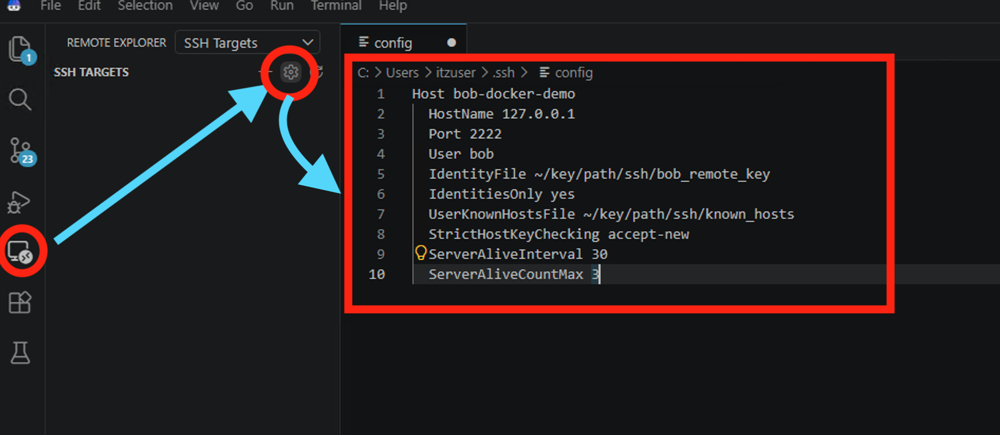

# Bob リモート接続 (Remote-SSH) 手順

IBM Bob から、[docker-setup.md](docker-setup.md) で用意したコンテナに Remote-SSH で接続する。

```
IBM Bob ── SSH 127.0.0.1:2222 ──▶ コンテナ bob-remote-host (Ubuntu 24.04 / x86_64)
```


> **`<PROJECT_DIR>` について**: 手順中の `<PROJECT_DIR>` は、このリポジトリを置いたディレクトリの絶対パスを表す。
> 自分の環境に合わせて書き換えること (docker-setup.md の M3 / W4 で `ssh/config` に書いたものと同じパス)。

## 仕組み

- Bob には Remote-SSH 拡張 `Open Remote - SSH` (`jeanp413.open-remote-ssh`) が同梱されているので、インストール不要
  (Mac 版 Bob 1.126.0+bob2.2.3 で確認)
- マーケットプレース (Open VSX) 版は入れないこと。Bob 用に手が加えられた同梱版が置き換わってしまう
  (誤って入れた場合は、マーケットプレース版をアンインストールすれば同梱版に戻る)
- 拡張は SSH の個人設定 (Mac: `~/.ssh/config` / Windows: `%USERPROFILE%\.ssh\config`) の `Host bob-docker-demo` を使って接続し、
  初回接続時にコンテナへ Bob のサーバーを自動でインストールする

接続先の設定は SSH の個人設定に追記する (Bob の画面から編集できる)。
個人設定以外の場所に置きたい場合は、末尾の「[オプション: ~/.ssh/config 以外に設定を置く](#オプション-sshconfig-以外に設定を置く)」を参照。

---

## 接続手順 (Mac / Windows 共通)

Mac と Windows で操作は同じ。違いは次の 2 点だけ。

| | Mac | Windows |
| --- | --- | --- |
| ショートカットの修飾キー | `Cmd` | `Ctrl` |
| docker-setup.md で作った設定ファイル | `ssh/config` (M3) | `ssh\config_windows` (W4) |

### 1. `~/.ssh/config` に接続先を追加する (初回のみ)

1. Bob の左端のアクティビティバーで **リモート エクスプローラー** (Remote Explorer) を開き、上部のプルダウンで `SSH Targets` を選ぶ
2. `SSH TARGETS` の右にある歯車アイコン (`Configure`) を押す。`~/.ssh/config` (Windows: `C:\Users\<ユーザー名>\.ssh\config`) がエディタで開く
3. docker-setup.md で書き換えた設定ファイル (Mac: `ssh/config` / Windows: `ssh\config_windows`) の `Host bob-docker-demo` ブロックを、ファイルの末尾にそのまま貼り付けて保存する

貼り付ける内容 (`<PROJECT_DIR>` は書き換え済みのもの):

```sshconfig
Host bob-docker-demo
  HostName 127.0.0.1
  Port 2222
  User bob
  IdentityFile <PROJECT_DIR>/ssh/bob_remote_key
  IdentitiesOnly yes
  UserKnownHostsFile <PROJECT_DIR>/ssh/known_hosts
  StrictHostKeyChecking accept-new
  ServerAliveInterval 30
  ServerAliveCountMax 3
```



画像は Windows 版の画面。画像内のパス (`~/key/path/...`) は例なので、自分の設定ファイルの内容を貼ること。

**確認**: 保存すると `SSH TARGETS` に `bob-docker-demo` が表示される。ターミナル (Windows は PowerShell) で次を実行し、`bob` と `x86_64` が表示されれば OK。

```sh
ssh bob-docker-demo 'whoami; uname -m'
```

歯車で `~/.ssh/config` 以外のファイルが開いた場合は、オプションの設定 (`remote.SSH.configFile`) が入っている。「うまくいかないとき」を参照。

### 2. 接続する

1. `Cmd + Shift + P` (Windows: `Ctrl + Shift + P`) → `Remote-SSH: Connect to Host...` → `bob-docker-demo` を選ぶ
2. 初回はサーバーの自動インストールが走るので待つ (30 秒ほど。リモートの OS を聞かれたら `Linux` を選ぶ)
3. `ファイル > フォルダーを開く...` (`File > Open Folder...`) → `/home/bob/workspace/demo-app` を開く
4. ターミナルで `whoami` が `bob`、`uname -m` が `x86_64` なら成功

Windows での接続 (手順 2) は実機では未確認。合わないときは「うまくいかないとき」を見ること。

---

## オプション: ~/.ssh/config 以外に設定を置く

`~/.ssh/config` を触りたくない場合は、手順 1 の代わりに、プロジェクト内の設定ファイル (Mac: `ssh/config` / Windows: `ssh\config_windows`) を Bob に直接読ませる。その後、手順 2 に進む。

Bob で `Cmd + Shift + P` (Windows: `Ctrl + Shift + P`) → `基本設定: ユーザー設定を開く (JSON)` (英語表示では `Preferences: Open User Settings (JSON)`) を開き、次の 1 行を追加して保存する。前の行の末尾に `,` を付けるのを忘れずに。

Mac:

```jsonc
"remote.SSH.configFile": "<PROJECT_DIR>/ssh/config"
```

(ファイルは `~/Library/Application Support/IBM Bob/User/settings.json`)

Windows:

```jsonc
"remote.SSH.configFile": "<PROJECT_DIR>/ssh/config_windows"
```

(ファイルは通常 `%APPDATA%\IBM Bob\User\settings.json`。区切りは `/` のままにする。`\` を使う場合は JSON では `\\` と書く必要がある)

注意:

- この設定がある間、Bob は `~/.ssh/config` を読まない (既存のホストも `SSH TARGETS` に表示されなくなる)。手順 1 の歯車もこのファイルを開く
- ユーザー設定専用で、ワークスペース設定には書けない (設定画面の「ワークスペース」タブには表示されない)
- ターミナルから接続するときは `-F` でファイルを指定する (Mac: `ssh -F ssh/config bob-docker-demo` / Windows: `ssh -F ssh\config_windows bob-docker-demo`)

---

## 片付け

手順 1 で追加した `Host bob-docker-demo` のブロックを `~/.ssh/config` (Windows: `%USERPROFILE%\.ssh\config`) から消す (手順 1 の歯車で開いて削除できる)。

オプションを使った場合は、代わりに Bob のユーザー設定から `remote.SSH.configFile` の行を消す。

コンテナの片付けは [docker-setup.md](docker-setup.md) の「片付け」を参照。

---

## うまくいかないとき

| 症状 | 対処 |
| --- | --- |
| リモート エクスプローラーに `SSH Targets` が無い / `Remote-SSH: Connect to Host...` が出ない | 拡張機能ビュー (`Cmd/Ctrl + Shift + X`) で `@builtin open-remote-ssh` を検索して有効にする。見つからなければ Bob を最新版に更新する |
| 歯車を押してもファイルが開かない / エラーになる | `.ssh` フォルダーが無い。Mac: `mkdir -p ~/.ssh` / Windows: `New-Item -ItemType Directory -Force $HOME\.ssh` を実行してから押し直す |
| 歯車で `~/.ssh/config` 以外のファイルが開く | オプションの `remote.SSH.configFile` が設定されている。既定の手順にするなら、Bob のユーザー設定からその行を消す |
| `SSH TARGETS` に `bob-docker-demo` が出ない | `~/.ssh/config` を保存したか確認し、`SSH TARGETS` の更新ボタンを押す。オプションの `remote.SSH.configFile` が残っていると `~/.ssh/config` は読まれない |
| 接続できない (`Connection refused` / タイムアウト) | コンテナが止まっている。docker-setup.md の M5 / W6 で接続を確認し、だめなら docker-setup.md の「うまくいかないとき」を見る |
| サーバーのインストールに失敗する | 下の「サーバーのインストールに失敗する場合の確認」を行う |
| (Mac) 接続が遅い・固まる | docker-setup.md の M1 (Rosetta) を確認する |
| (Windows) 手順 1 の確認で `Bad owner or permissions on ...\.ssh\config` | `.ssh\config` に他のユーザーのアクセス権が付いている。`icacls $HOME\.ssh\config /inheritance:r /grant:r "$(whoami):(F)"` |

**サーバーのインストールに失敗する場合の確認**

Mac:

```sh
ssh -F ssh/config bob-docker-demo 'uname -m; curl -sSI https://github.com | head -1'
```

Windows:

```powershell
ssh -F ssh\config_windows bob-docker-demo 'uname -m; curl -sSI https://github.com | head -1'
```

`x86_64` と `HTTP/2 200` が出れば問題ない。

- `x86_64` 以外: コンテナが amd64 で動いていない (docker-setup.md の「うまくいかないとき」を参照)
- `HTTP/2 200` が出ない: コンテナから外部に出られない。プロキシ環境なら、Bob のユーザー設定 (`基本設定: ユーザー設定を開く (JSON)`) に、サーバーのダウンロードに使うプロキシを指定する
  ```jsonc
  "remote.SSH.httpsProxy": { "bob-docker-demo": "http://proxy.example.com:3128" }
  ```

構成の詳細は [README.md](README.md) を参照。
